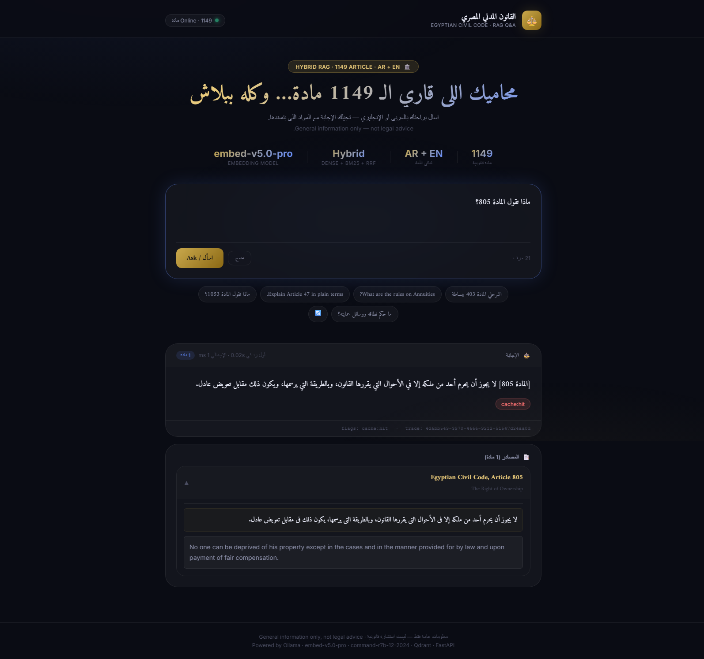
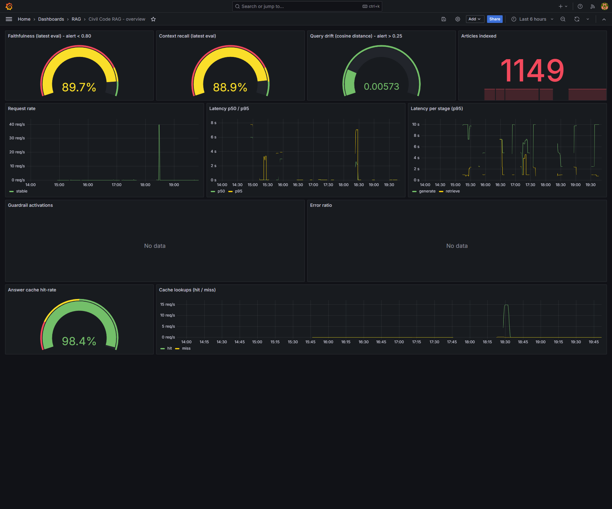
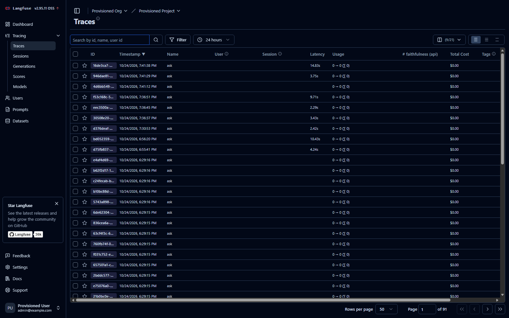
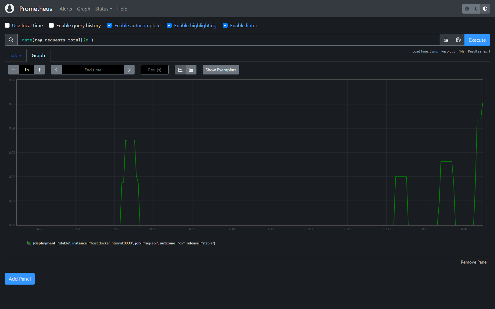
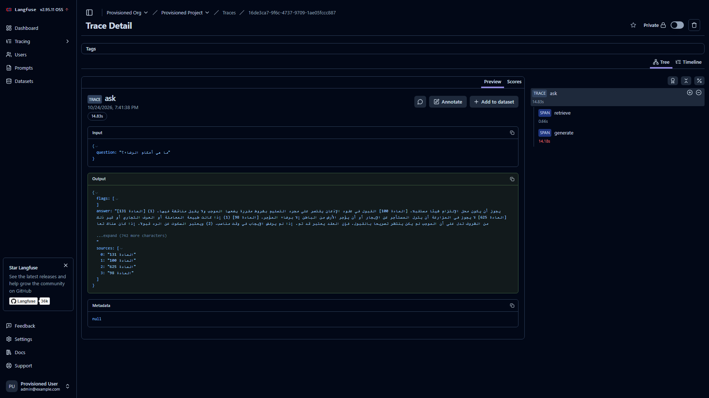
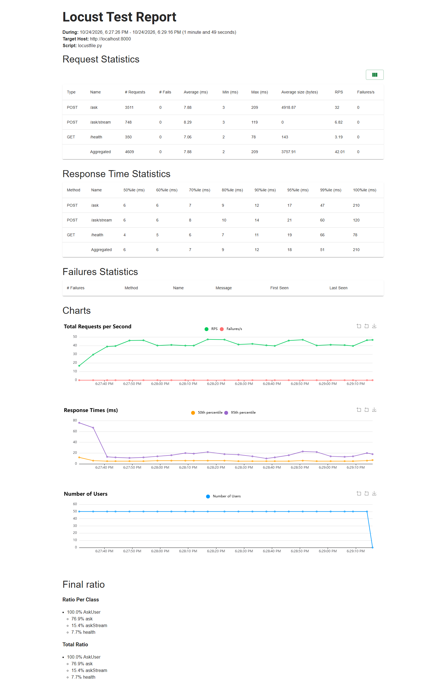

# قانون-RAG — أسئلة وأجوبة على القانون المدني المصري

قانون-RAG هو مشروع تخرجي في كورس الـ MLOps: خدمة RAG بشكل production بتجاوب على الأسئلة عن القانون المدني المصري (1149 مادة، بالعربي والإنجليزي) وبتستند برقم المادة اللي جايت منها الإجابة. بترفض الأسئلة اللي خارج نطاق القانون، بتصد محاولات حقن الـ prompt، بتخفي أي بيانات شخصية، وكل إجابة ليها trace كامل أقدر أرجعله في Langfuse.

الصفحة دي مكتوبة كـ runbook شخصي بتاعي: بالظبط اللي بعمله على جهاز جديد عشان أشغل المشروع كله، وكل اللينكات اللي بفتحها عشان أتأكد منه وأعرضه. امشي بيها من فوق لتحت هتوصل لنفس SETUP اللي بعرضه.

English: [README.md](README.md)


*إجابة حقيقية واحدة من أولها لآخرها: السؤال، وأرقام المواد المستشهد بيها، والنص الكامل للمصدر بالعربي والإنجليزي ورا كل استشهاد، وزمن الاستجابة، والـ trace id بتاع Langfuse تحت الكارت.*

## اللي محتاجه قبل ما تبدأ

- Python 3.10 أو أحدث
- Node.js 18 أو أحدث (لواجهة الـ Next.js)
- Docker Desktop عشان Prometheus وGrafana وAlertmanager وLangfuse. الـ API نفسه مش محتاج Docker خالص.
- مفتاح Cohere API. الـ free trial كفاية، أنا شغال بيه فعلا. أي endpoint متوافق مع OpenAI يشتغل برضه، وفيه fallback أوفلاين كامل لو معندكش دول.
- شوية دقايق صبر أول مرة: بناء الـ index بيمشي متبطئ عمدا عشان ميتعداش حد الـ rate limit بتاع الـ trial.

## 1. اعلمل clone وثبّت

```bash
git clone https://github.com/ahmdeltoky03/Qanun-RAG.git
cd Qanun-RAG
python -m venv .venv
# ويندوز PowerShell:  .venv\Scripts\Activate.ps1
# لينكس / WSL:        source .venv/bin/activate
pip install -e ".[dev,ui]"
```

أنا بشغل على ويندوز جوه WSL، والأوامر واحدة في الحالتين.

## 2. ظبط ملف .env

```bash
cp .env.example .env      # على ويندوز: copy .env.example .env
```

افتح `.env` وحط مفتاح Cohere بتاعك في مكانين: `QANUN_EMBEDDING_API_KEY` و`QANUN_LLM_API_KEY` (نفس المفتاح). القيم الافتراضية أصلا موجهة الـ embeddings لـ Cohere `embed-v5.0-pro` ونموذج الحوار لـ `command-r7b-12-2024` عن طريق الـ endpoint المتوافق مع OpenAI بتاع Cohere، وده بالظبط SETUP بتاعي. ملف `.env` متضاف في gitignore، ماتعملوش commit أبدا.

حاجتين مهمين في الملف:

- `QANUN_EMBEDDING_RPM=18` بيخلي عميل الـ embeddings تحت سقف الـ trial (20 طلب في الدقيقة). سيبه زي ما هو.
- `QANUN_CORS_ORIGINS` لازم فيه `http://localhost:3000` وإلا الواجهة في المتصفح مش هتقدر تكلم الـ API.

معندكش مفتاح؟ في آخر `.env.example` fallback أوفلاين كامل (embeddings hashing وLLM وهمي). كل حاجة هتشتغل والاختبارات هتعدي، بس الإجابات هتبقى placeholder.

## 3. ابن الـ vector index

```bash
qanun-build-corpus    # PDF -> data/processed/civil_code.json (متعمله commit بالفعل، فغالبا هتعدي الخطوة دي)
qanun-ingest          # embeddings لحوالي 3450 قطعة -> index محلي لـ Qdrant تحت data/index
```

ملف الـ corpus متواجد في الريبو، فعمليا أنت هتشغل `qanun-ingest` بس. اللي بياخد وقت فيه فعلا هو نداءات الـ embedding: الـ 1149 مادة بيتقطعوا لـ 3450 قطعة، وCohere بياخد 96 نص في الطلب الواحد، يعني 36 طلب ماشيين على مهل بسقف `QANUN_EMBEDDING_RPM=18` (سقف الـ trial نفسه 20 في الدقيقة) — يعني حوالي دقيقتين انتظار متعمد، زيادة عليهم backoff الـ retry لو جه 429 مرة هنا وهناك. بتحتاج تعيد البناء بس لو غيرت نموذج الـ embeddings، لأن المتجهات بتاعة نموذج معين (2048 بُعد في حالة embed-v5.0-pro).

مهم: الـ index المدمج بيتقفل من العملية اللي فتحته. ماتشغلش `qanun-ingest` (أو eval أوفلاين) والـ API شغال.

## 4. شغل الـ API

```bash
make run
# زي ما هو: uvicorn qanun.api.main:get_app --factory --host 0.0.0.0 --port 8000
```

باربط على 0.0.0.0 عمدا: حاوية Prometheus بتسحب الـ metrics من الـ API عن طريق عنوان الـ Docker host، والـ bind على loopback بس مش بيبان من جوه الحاويات.

## 5. شغل الواجهة

```bash
cd frontend
npm install
npm run dev
```

## 6. شغل stack الـ observability

والـ Docker Desktop شغال:

```bash
docker compose --profile tracing up -d --no-deps langfuse-db langfuse prometheus grafana alertmanager
```

فلاج `--no-deps` بيخليه ميبنيش صور الـ API في Docker: أنا بشغل الـ API native، وبناء الصور دول كان هيعيد ingest الكوربس كله على حد الـ rate limit من غير فايدة. أول مرة بس، Langfuse ممكن يخسر السباق مع الـ postgres بتاعه ويطلع exited؛ لو شفت كده في `docker ps` نفذ نفس الأمر تاني. الحاويات ملهاش restart policy، فبعد أي reboot ببرجع أنفذ الأمر ده مع `make run`.

## كل اللينكات اللي بفتحها

التطبيق والـ API، من غير Docker:

- http://localhost:3000 — واجهة الـ Next.js. شات عربي RTL، التوكنز بتتكتب live، وكل كارت إجابة فيه زمن الاستجابة والمواد المصدر بنصها الكامل والـ trace id بتاع Langfuse.
- http://localhost:8000/docs — Swagger UI لكل الـ API، مفيد لو عايز تجرب endpoint بإيدك.
- http://localhost:8000/health — الحالة وعدد المواد المتفهرسة وأسماء النماذج وهل الـ tracing شغال.
- http://localhost:8000/metrics — الـ metrics الخام بتاعت Prometheus.
- http://localhost:8000/suggest?n=5 — أسئلة عشوائية متولدة من الكوربس كله؛ الشيبس المقترحة في الواجهة جاية من هنا.

الدشبوردات والـ tracing، من stack الـ Docker:

- http://localhost:9090 — Prometheus، من غير login. جرب `rate(rag_requests_total[2m])` أو هيستوجرامات `rag_stage_seconds`. لينك جاهز: [rate(rag_requests_total[2m]) على آخر ساعة](http://localhost:9090/graph?g0.expr=rate(rag_requests_total%5B2m%5D)&g0.tab=0&g0.range_input=1h).
- http://localhost:3001 — Grafana، الدخول admin / admin (أو `GRAFANA_PASSWORD` بتاعك). افتح داشبورد RAG Overview: معدل الطلبات، percentiles الزمن، نسبة إصابات الكاش، عدد المواد، وعداد الـ faithfulness اللي بيقرأ `reports/latest_eval.json` مع كل scrape. لينك مباشر: [داشبورد Civil Code RAG](http://localhost:3001/d/rag-overview/civil-code-rag-overview?orgId=1).
- http://localhost:9093 — Alertmanager. بينور لما الـ faithfulness تنزل تحت 0.80 أو معدل الأخطاء يعلى.
- http://localhost:3100 — Langfuse، الدخول admin@example.com / change-me-now والمشروع `civil-code`. كل /ask و/ask/stream بيبقى trace كامل. ساكن على 3100 لأن 3000 بتاع الواجهة. لينك مباشر: [قائمة الـ traces](http://localhost:3100/project/civil-code/traces).

## شكله إزاي وهو شغال

كل اللي تحت ده متصور من الـ stack وهو شغال فعلا على جهازي، مش mock.


*[داشبورد RAG Overview](http://localhost:3001/d/rag-overview/civil-code-rag-overview?orgId=1) بعد session حقيقي: عدادات الـ faithfulness والـ context recall اللي بتتغذى من آخر eval، و1149 مادة متفهرسة، وذبذبة معدل الطلبات من الـ load test، والزمن لكل مرحلة، ونسبة إصابة الكاش 98.4 في المية. الـ guardrail activations والـ error ratio قرايين "No data" لأن مفيش حاجة عدّت عليهم، ودي أصلا النقطة.*


*[قائمة الـ traces في Langfuse](http://localhost:3100/project/civil-code/traces): كل طلب عملته النهارده بزمنه. الخانات الفاضية في عمود الزمن دي إجابات جاية من الكاش من غير نداء توليد.*


*نفس الـ load test متشاف من [Prometheus](http://localhost:9090/graph?g0.expr=rate(rag_requests_total%5B2m%5D)&g0.tab=0&g0.range_input=1h): الـ `rate(rag_requests_total[2m])` بيطلع لحوالي 40 طلب في الثانية ويرجع لصفر لما Locust بيقف.*

## بعرض الـ tracing إزاي

باسأل سؤال في الواجهة، بانسخ الـ trace id المطبوع تحت كارت الإجابة، وبدور بيه في Traces في Langfuse على http://localhost:3100/project/civil-code/traces. الـ trace بيبين السلسلة كلها: الـ guardrails، والاسترجاع الهجين (dense مع BM25 مدموجين بـ RRF)، والتوليد من Cohere، وفحص الاستشهاد، وسكور الـ faithfulness اللي بيتعلق بالـ trace بعدها. حتى من غير id، قائمة الـ traces بتعرض آخر الطلبات بزمنها وعدد التوكنز، ودي اللي بفتحها وأنا مشغل load test.


*trace واحد لـ /ask مفتوح بالـ id: السؤال الداخل، والإجابة المتولدة بالمواد المصدر اللي استشهدت بيها، وعلى اليمين شجرة الـ spans، استرجاع في 0.66 ثانية وبعدها توليد في 14.18 ثانية، جوه trace مدته 14.83 ثانية.*

## الجودة: الـ eval وبوابة الـ CI

```bash
make eval     # الـ 58 سؤال كله -> reports/latest_eval.json (حوالي 4 دقايق)
make gate     # نفس التشغيل بس بيرجع exit code غلط لو الـ faithfulness أقل من 0.75
```

آخر تشغيل كامل ليا: faithfulness 0.897، context recall 0.889، hit@k 0.889، MRR 0.776، دقة الاستشهاد 0.648، رفض خارج النطاق 1.00، وp50 للزمن 2.05 ثانية. الـ CI بيشغل البوابة دي على كل pull request. لو الـ API شغال استخدم `qanun-eval --api http://localhost:8000` عشان الـ eval مايتخانقش على قفل الـ index.

## الـ load test

```bash
make loadtest     # 50 مستخدم لمدة دقيقتين، Locust headless
# بيكتب reports/locust.html و reports/locust_*.csv
```

الـ API بيعمل cache للإجابات جوه العملية، فأنا بسخن الكاش الأول بتشغيل مجموعة الـ eval مرة على الـ API الشغال (`qanun-eval --api http://localhost:8000`). كده الـ load test بيقيس مسار التقديم عندي مش كوتة Cohere. آخر تشغيل دافي ليا: 4609 طلب، صفر failures، و/ask بزمن p50 يساوي 6 ms وp95 يساوي 17 ms وp99 يساوي 47 ms، وحولي 42 طلب في الثانية إجمالا. التقرير الكامل موجود في الريبو: [reports/locust.html](reports/locust.html).


*[تقرير Locust](reports/locust.html) للتشغيل ده: 50 مستخدم لمدة دقيقتين، 4609 طلب، صفر failures، والـ percentiles بتاعة الزمن ثابتة ومعدل الطلبات ماسك حوالي 40 في الثانية.*

## الاختبارات والـ lint

```bash
make test     # 66 اختبار
make lint     # ruff check + format check
```

## اختياري: الـ stack كامل في Docker

`make up` بيبني ويشغل كل حاجة متحوية، ومنها nginx بتوجيه canary موزون على http://localhost:8080 (`scripts/canary.sh 10` يودي 10 في المية للـ canary، و0 يرجع، و100 يرقّي). أنا بستخدم المسار ده بس في تمارين الـ deploy: بناء صورة الـ API بيعيد ingest الكوربس على حد الـ rate limit، وعشان كده SETUP اليومي بتاعي هو الـ API native مع حاويات الـ collectors اللي فوق.

## حاجات هتعضك، لأنها عضتني كلها

- "index folder in use": يعني الـ API شغال. وقفه قبل الـ ingest أو الـ eval الأوفلاين.
- Langfuse بيطلع exited أول مرة: خسر السباق مع postgres. نفذ أمر الـ compose مرة تانية.
- الدشبوردات ميتة بعد reboot: مفيش restart policy على الحاويات. نفذ أمر الـ compose و`make run` تاني.
- الواجهة بتقول Offline مع إن curl على /health شغال: `http://localhost:3000` مش متضاف في `QANUN_CORS_ORIGINS`.
- مفيش حاجة بتتغير بعد تعديل .env: الإعدادات بتتقرأ مرة واحدة عند الإقلاع، اعمل restart للـ API.
- خطأ `vector dimension` بعد تغيير نموذج الـ embeddings: أعد بناء الـ index بـ `qanun-ingest`.
- المادة 1022 ملهاش نص عربي في الـ PDF المصدر. ده عيب في المستند المصدر مش في الـ pipeline.

## حدود معروفة

- الأسئلة المبهمة أو خارج النطاق بتترفض بالتصميم؛ دي الـ guardrails بتشتغل.
- الـ fallback الأوفلاين موجود للـ smoke tests والـ CI مش لجودة الإجابات.
- معلومات عامة فقط، ليست استشارة قانونية.

## خريطة الريبو والـ branches

`src/qanun` هو الباكدج القابل للتثبيت (api وcorpus وretrieval وrag وllm وguardrails وeval وobservability). `tests/` فيه مجموعة pytest، و`frontend/` تطبيق الـ Next.js، و`monitoring/` قواعد Prometheus والداشبورد، و`loadtest/` بروفايل Locust، و`reports/` بيجمع نواتج الـ eval والـ load test.

`main` بياخد merges من الـ feature branches بس؛ الـ branch بتاع تطويري الحالي هو `feat/cohere-provider`. الـ branches الأقدم `feat/*` كل واحد فيهم بيعزل شريحة من النظام (pipeline الكوربس، الاسترجاع، الـ API والـ observability، التقييم، الواجهة، الـ deploy) عشان كل قطعة تتراجع لوحدها.
